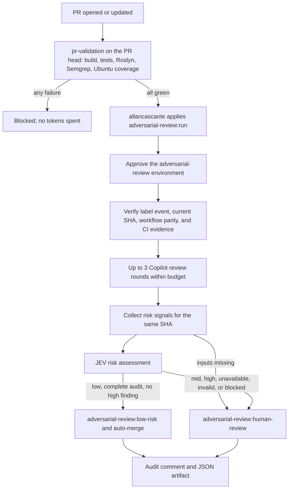

# How to Run the JEV Risk Assessment

This guide explains how the TypeSafe JEV risk assessment works, how to run it,
where its configuration lives, and how it connects to the adversarial review flow.
The governing rules are in the
[specification](adversarial-reviewer-agent-spec.md#6-risk-model-and-decision-record).

## What it does

JEV receives a `low`, `mid`, or `high` classification for each risk factor and
returns one overall classification. The orchestrator validates the answer and
applies the blocking rules independently.

| Factor | Low | Mid | High |
|---|---|---|---|
| Changed code lines (added + deleted) | 0–100 | 101–1,000 | 1,001 or more |
| Coverage of added executable lines | 100% | More than 80% and less than 100% | 80% or less |
| Adversarial findings | 0–2 low, no mid | 3+ low or 1 mid | 2+ mid |
| New static-analysis warnings | 0–1 | 2 | 3 or more |

The boundaries, the pinned JEV model, and the request timeout are in
[`adversarial-review/config/risk-rubric.json`](../adversarial-review/config/risk-rubric.json).
Change the values and the `version` field together so each assessment records
which rubric produced it.

A PR is **eligible** for the low-risk label only when JEV answers `low` and no
unresolved high or critical finding exists. A failed build, test, or required
static-analysis check blocks before JEV runs. If JEV is unavailable, times out,
or returns an unexpected answer, the result is recorded as `unavailable` or
`invalid`, is not retried, and never makes the PR eligible.

JEV receives only the factor classifications, the rubric version, and whether
integration tests exist and a high finding is unresolved. It does not receive
source code, file paths, finding text, or user identities.

## Run it

### 1. Inspect the request without sending it

```text
dotnet run --project adversarial-review/src/AdversarialReview.Cli -- assess-risk adversarial-review/config/risk-rubric.json adversarial-review/tests/fixtures/risk-signals.sample.json request.json --dry-run
```

This writes the exact JSON that would be sent. It reads no credential and makes
no network request.

### 2. Call JEV from your machine

Set `JEV_API_KEY` in your shell from your TypeSafe console; never pass it as an
argument. Then omit `--dry-run`:

```text
dotnet run --project adversarial-review/src/AdversarialReview.Cli -- assess-risk adversarial-review/config/risk-rubric.json adversarial-review/tests/fixtures/risk-signals.sample.json assessment.json
```

The output contains the factors, the assessment, and the decision. The command
exits `0` when assessed and `3` when the assessment is `unavailable` or
`invalid`. Do not commit the output file.

To try other inputs, copy the sample signals file and edit the counts. Every
field is required; a missing count is rejected rather than treated as zero.

### 3. Call JEV from GitHub Actions

1. In **Settings → Environments → `adversarial-review`**, add the environment
   secret `JEV_API_KEY` and the required reviewers.
2. After the [`jev-risk-smoke`](../.github/workflows/jev-risk-smoke.yml) workflow is
   on `main`, open **Actions → jev-risk-smoke → Run workflow**. GitHub only lists
   manually triggered workflows that exist on the default branch.
3. Approve the environment deployment. The job summary shows the result and the
   artifact contains the request and assessment.

The smoke test uses the synthetic sample signals, not values from a real PR.

### Verified result

On November 27, 2026, a local live call with the sample signals returned
`status: assessed`, `classification: low`, confidence `0.79`, probabilities
`low 0.86 / mid 0.13 / high 0.01`, answered by `jev-1.14.0`, using 657 input
and 40 output tokens. The smoke workflow has not yet run in Actions.

## Where configuration lives

| Setting | Location |
|---|---|
| `adversarial-review` environment with required reviewers (self-review allowed) | GitHub settings → Environments |
| `COPILOT_GITHUB_TOKEN` (fine-grained PAT with Copilot Requests) and `JEV_API_KEY` | GitHub settings → Environment secrets |
| **Allow auto-merge** | GitHub settings → General |
| Branch protection and required checks for `main` | GitHub settings → Branches |
| Authorized actor, label, rounds, budgets, billing, model pool | [`config/review.json`](../adversarial-review/config/review.json) |
| Risk boundaries, JEV model, timeout | [`config/risk-rubric.json`](../adversarial-review/config/risk-rubric.json) |
| Reviewer prompt | [`.github/prompts/adversarial-review.prompt.md`](../.github/prompts/adversarial-review.prompt.md) |
| Trigger and job wiring | [`adversarial-review.yml`](../.github/workflows/adversarial-review.yml), [`pr-validation.yml`](../.github/workflows/pr-validation.yml) |

Secrets, environments, reviewers, and repository settings are configured on the
GitHub website. Policy values, prompts, and workflow logic are versioned in the
repository so every change is reviewed.

The approved budgets are 3 rounds, 60,000 input and 8,000 output tokens, a 120 s
timeout, 1 retry, USD 1 per authorization, and USD 20 per month. GitHub bills
Copilot in AI credits at USD 0.01 each and the SDK reports nano-units of a credit,
so `copilotBilling` uses 1,000,000,000 nano-units per credit; USD 20 is 2,000 credits.

## How it runs



Apply the label **after** the checks finish. The trusted
[workflow](../.github/workflows/adversarial-review.yml) fails if the newest
validation run for the head is incomplete or failed. To review a new commit,
remove and reapply the label.

Auto-merge uses GitHub's auto-merge with a merge commit, bound to the evaluated
head SHA. Branch protection still applies, so GitHub merges only after the required
human approval and checks. A later run that is not eligible disables auto-merge.

Spend is stored in a SQLite ledger committed to the `adversarial-review-ledger`
branch after every run. Runs are serialized across all PRs. If a runner crashes
before the push, that run's spend record is lost; this is accepted for the pilot.

## How the signals are collected

Every signal comes from the evaluated head SHA. The trusted workflow never runs PR
code: values produced by running the code come from `pr-validation` artifacts,
which are verified against their SHA-bound manifests before use.

| Signal | Source |
|---|---|
| Changed code lines | GitHub PR files API: additions plus deletions, excluding `*.md`, `docs/`, `release-notes/`, `Test/SqlDom/TestScripts/`, and `Test/SqlDom/Baselines*/` |
| Added-line coverage | Cobertura report from the Ubuntu parser test run, matched against the added lines in each file's patch |
| Adversarial findings | Unresolved low and medium findings from the review; high or critical findings set the separate blocker |
| New static-analysis warnings | Semgrep SARIF results and distinct Roslyn warnings in files the PR changed |
| Integration tests | Present when the PR adds or changes a parser round-trip script under `Test/SqlDom/TestScripts/` together with a baseline of the same name |

If coverage, analysis reports, the review rounds, or a needed patch are missing,
JEV is not called and the PR receives the human-review label.

### Known limitations

- Coverage comes only from the parser suite (`UTSqlScriptDom`). Changes limited to
  `adversarial-review/` have no instrumented lines, so coverage is `not-applicable`.
- Coverage excludes generated parser sources under `obj/`. If the report exceeds
  20 MiB it is dropped and the PR goes to human review.
- The validation workflow now tests the PR head commit instead of GitHub's merge
  result, so evidence and line numbers match the audited SHA.
- Grammar files are large; their review context can exceed the token budget, which
  ends the review as `budget-exceeded` and sends the PR to human review.

### Future investigation: new warnings against the base commit

"New static-analysis warnings" is currently approximated as warnings reported in
files the PR changed on the head commit. A warning that already existed in a
changed file is counted, and a new warning caused in an unchanged file is not.
A precise count would run Roslyn and Semgrep on the base commit too and subtract
its results, at the cost of roughly doubling the static-analysis job. This was
deferred and should be revisited with real pilot data.

## Open decisions

- Calibration acceptance after pilot runs, and any rubric adjustments.
- Whether to keep the required human approval for low-risk PRs before auto-merge.
