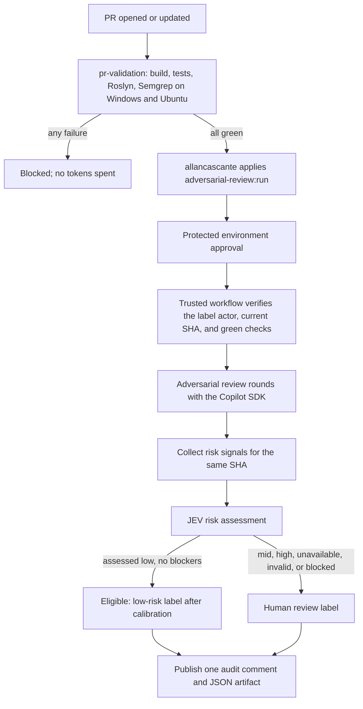

# How to Run the JEV Risk Assessment

This guide explains how the TypeSafe JEV risk assessment works, how to run it,
where its configuration lives, and how it connects to the adversarial review flow.
The governing rules are in the
[specification](adversarial-reviewer-agent-spec.md#6-risk-model-and-decision-record).

## What it does

JEV receives a `low`, `mid`, or `high` classification for each risk factor and
returns one overall classification. The orchestrator validates the answer and
applies the blocking rules independently.

| Factor | Low | Mid | High |
|---|---|---|---|
| Changed code lines (added + deleted) | 0–100 | 101–1,000 | 1,001 or more |
| Coverage of added executable lines | 100% | More than 80% and less than 100% | 80% or less |
| Adversarial findings | 0–2 low, no mid | 3+ low or 1 mid | 2+ mid |
| New static-analysis warnings | 0–1 | 2 | 3 or more |

The boundaries, the pinned JEV model, and the request timeout are in
[`adversarial-review/config/risk-rubric.json`](../adversarial-review/config/risk-rubric.json).
Change the values and the `version` field together so each assessment records
which rubric produced it.

A PR is **eligible** for the low-risk label only when JEV answers `low` and no
unresolved high or critical finding exists. A failed build, test, or required
static-analysis check blocks before JEV runs. If JEV is unavailable, times out,
or returns an unexpected answer, the result is recorded as `unavailable` or
`invalid`, is not retried, and never makes the PR eligible.

JEV receives only the factor classifications, the rubric version, and whether
integration tests exist and a high finding is unresolved. It does not receive
source code, file paths, finding text, or user identities.

## Run it

### 1. Inspect the request without sending it

```text
dotnet run --project adversarial-review/src/AdversarialReview.Cli -- assess-risk adversarial-review/config/risk-rubric.json adversarial-review/tests/fixtures/risk-signals.sample.json request.json --dry-run
```

This writes the exact JSON that would be sent. It reads no credential and makes
no network request.

### 2. Call JEV from your machine

Set `JEV_API_KEY` in your shell from your TypeSafe console; never pass it as an
argument. Then omit `--dry-run`:

```text
dotnet run --project adversarial-review/src/AdversarialReview.Cli -- assess-risk adversarial-review/config/risk-rubric.json adversarial-review/tests/fixtures/risk-signals.sample.json assessment.json
```

The output contains the factors, the assessment, and the decision. The command
exits `0` when assessed and `3` when the assessment is `unavailable` or
`invalid`. Do not commit the output file.

To try other inputs, copy the sample signals file and edit the counts. Every
field is required; a missing count is rejected rather than treated as zero.

### 3. Call JEV from GitHub Actions

1. In **Settings → Environments → `adversarial-review`**, add the environment
   secret `JEV_API_KEY` and the required reviewers.
2. After the [`jev-risk-smoke`](../.github/workflows/jev-risk-smoke.yml) workflow is
   on `main`, open **Actions → jev-risk-smoke → Run workflow**. GitHub only lists
   manually triggered workflows that exist on the default branch.
3. Approve the environment deployment. The job summary shows the result and the
   artifact contains the request and assessment.

The smoke test uses the synthetic sample signals, not values from a real PR.

### Verified result

On November 27, 2026, a local live call with the sample signals returned
`status: assessed`, `classification: low`, confidence `0.79`, probabilities
`low 0.86 / mid 0.13 / high 0.01`, answered by `jev-1.14.0`, using 657 input
and 40 output tokens. The smoke workflow has not yet run in Actions.

## Where configuration lives

| Setting | Location | Status |
|---|---|---|
| `adversarial-review` environment, required reviewers | GitHub settings → Environments | Not verified as configured |
| `JEV_API_KEY` secret | GitHub settings → Environment secrets | Must be added |
| Copilot SDK credential for the adversarial review | GitHub settings → Environment secrets | Not configured; no paid review runs yet |
| `adversarial-review:run` label | GitHub repository labels | Used by the preparation workflow |
| Branch protection and required checks | GitHub settings → Branches | Configured for `main` |
| Authorized actor, label, rounds, budgets, model pool | [`config/review.json`](../adversarial-review/config/review.json) | Paid execution disabled; limits unset |
| Risk boundaries, JEV model, timeout | [`config/risk-rubric.json`](../adversarial-review/config/risk-rubric.json) | Initial values |
| Trigger and job wiring | [`.github/workflows/`](../.github/workflows) | Preparation only; see below |

Secrets, environments, reviewers, and labels are configured on the GitHub
website. Policy values and the workflow logic are versioned in the repository
so that every change is reviewed.

## How it connects to the review flow

The intended end-to-end flow is:



The trigger you described is how the existing
[preparation workflow](../.github/workflows/adversarial-review-prepare.yml) already
starts: the `adversarial-review:run` label, applied by `allancascante`, on a
non-draft PR targeting `main`, in the protected environment. It verifies that the
newest validation run for the current SHA is complete and green, and fails if it
is not, so apply the label **after** the checks finish. Today that workflow stops
after preparation: it does not run the adversarial review or call JEV.

### Implementation status

| Step | Status |
|---|---|
| Label trigger, actor check, environment, SHA-bound check verification | Implemented (preparation only) |
| Adversarial review rounds, budgets, ledger | Implemented and tested; not wired into a workflow |
| Persistent host for the spend ledger | Not deployed |
| Collection of real risk signals | Not implemented; see below |
| JEV client and decision rules | Implemented and tested |
| Audit comment publication | Implemented and tested; not wired into a workflow |
| Labels | Not implemented; disabled pending calibration |

### Collecting the real signals

Each signal must come from the same head SHA as the review and from evidence the
trusted workflow can verify. The trusted workflow must not run PR code, so values
produced by running the code are created by the untrusted validation workflow,
uploaded as artifacts with the existing SHA-bound manifest, and verified before use.

| Signal | Source | Work needed |
|---|---|---|
| Changed code lines | GitHub PR files API (`additions`, `deletions`) | Decide which files count as code, for example excluding docs and test baselines |
| Added-line coverage | Coverage report from the test run, intersected with the PR diff | Add coverage collection to `pr-validation`, compute covered/instrumentable added lines, and upload with the manifest |
| Adversarial findings | The review cycle's `audit.json` | Count low and medium findings and detect unresolved high/critical findings |
| New static-analysis warnings | Semgrep SARIF and Roslyn output from `static-analysis` | Compare against the base branch to count only new warnings |
| Integration tests | Test results | Define which tests count as integration tests; until then, send `unknown` |

### Open decisions

- Which files count as code lines.
- How to identify integration tests.
- Whether the flow should start automatically when checks complete while the
  label is present, or keep the current label-after-checks behavior.
- Host for the persistent spend ledger, Copilot credential, and budgets.
- Label names, calibration acceptance, and whether automatic merge is ever enabled.
